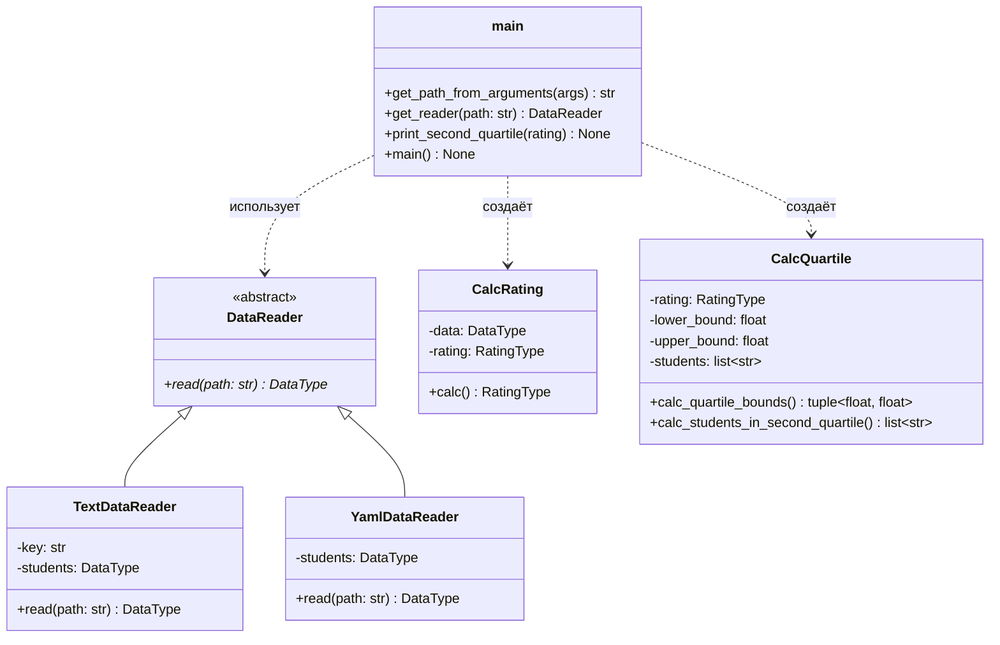

# Лабораторная 1 по дисциплине "Технологии программирования"

Знакомство с системой контроля версий Git и инструментом CI/CD GitHub Actions.

## Постановка задачи

Проект `rating` рассчитывает средний рейтинг студентов по дисциплинам на основе
списка студентов и полученных ими оценок, хранящегося в файле. Необходимо:

1. разработать ООП-проект и модульные тесты к нему на Python 3 с помощью `pytest`;
2. разместить проект в репозитории GitHub и настроить автоматическое тестирование
   (CI) средствами GitHub Actions;
3. выполнить индивидуальное задание (вариант 8): добавить класс-читатель данных
   формата **YAML** и класс, определяющий **всех студентов, чей рейтинг попадает
   во вторую квартиль распределения по рейтингам**;
4. оформить лицензию, `.gitignore`, UML-диаграмму классов и выводы.

## Краткое описание проекта

```
rating
  |----.github/workflows/github-actions-testing.yml
  |----data
  |     |----data.txt          # исходный текстовый формат
  |     |----data.yaml         # формат варианта 8 (YAML)
  |----src
  |     |----Types.py            # определения типов для Type Hints
  |     |----DataReader.py       # абстрактный класс читателя
  |     |----TextDataReader.py   # чтение .txt
  |     |----YamlDataReader.py   # чтение .yaml (вариант 8)
  |     |----CalcRating.py       # средний рейтинг студента
  |     |----CalcQuartile.py     # вторая квартиль рейтингов (вариант 8)
  |     |----main.py             # консольный интерфейс
  |----test
  |     |----test_TextDataReader.py
  |     |----test_YamlDataReader.py
  |     |----test_CalcRating.py
  |     |----test_CalcQuartile.py
  |     |----test_main.py
  |----LICENSE
  |----README.md
  |----requirements.txt
```

### Индивидуальное задание, вариант 8

Входной файл в формате YAML имеет вид списка отображений (как в методических
указаниях):

```yaml
- Иванов Иван Иванович:
    математика: 80
    программирование: 90
    литература: 76
```

Класс `YamlDataReader` — наследник `DataReader`; он приводит YAML к общему типу
`DataType = dict[str, list[tuple[str, int]]]`, поэтому весь остальной код проекта
не зависит от формата файла.

Класс `CalcQuartile` рассчитывает квартильные границы распределения рейтингов и
возвращает студентов, чей рейтинг попадает **во вторую квартиль**, то есть в
интервал `[Q1, Q2]` между первым квартильным значением и медианой. Границы
вычисляются функцией `statistics.quantiles(..., n=4, method="inclusive")`,
сравнение оценок выполняется с эпсилоном `1e-9` из-за накопления ошибок
представления вещественных чисел (средний рейтинг — результат деления).

Для `data/data.yaml` результат:

```text
Rating:  {'Иванов Иван Иванович': 82.0, 'Петров Петр Петрович': 83.66666666666667,
          'Абрамов Петр Сергеевич': 85.66666666666667}
Second quartile bounds:  82.83333333333334 83.66666666666667
Students in second quartile:  ['Петров Петр Петрович']
```

Если во вторую квартиль не попадает никто (например, для двух студентов
рейтинги 70 и 90 дают интервал `[75.0, 80.0]`), программа выводит сообщение об
отсутствии таких студентов, как и требует задание.

## Используемые языки, библиотеки и технологии

- Python 3.10 (локально — 3.12), стандартная библиотека `statistics`, `argparse`;
- `PyYAML` — разбор YAML;
- `pytest` — модульное тестирование (28 тестов);
- `pycodestyle` — проверка соответствия PEP8;
- Git, GitHub, GitHub Actions — контроль версий и CI.

## UML-диаграмма классов



## Ход работы

1. Проверка стиля и тесты локально:

   ```text
   pycodestyle src test
   $env:PYTHONPATH = "./:./src"   # Windows: разделитель ";", Linux/CI: ":"
   pytest test
   python ./src/main.py -p ./data/data.txt
   python ./src/main.py -p ./data/data.yaml
   ```

2. Создание репозитория `PTLab1` на GitHub, `git init`, настройка `user.name` /
   `user.email`, `git add -A`, `git commit`, `git branch -M main`,
   `git remote add origin`, `git push -u origin main` (авторизация по personal
   access token с правами `repo`, `workflow`).
3. Индивидуальное задание выполнялось в отдельной ветке
   `feature/variant8-yaml-quartile`, после чего ветка была смержена в `main`.
4. Проверка CI: пуш в `main` запускает workflow `Testing the Python code`
   (установка зависимостей, `pycodestyle src test`, `pytest test`). Добавление
   намеренной ошибки делает статус красным, исправление — снова зелёным.

## Теоретические вопросы

1. **Системы управления версиями** хранят историю изменений кода и позволяют
   нескольким людям работать параллельно. Локальные (RCS) ведут историю в одной
   копии, централизованные (SVN) — на едином сервере, распределённые (Git) —
   каждая копия является полным репозиторием с историей, что даёт работу офлайн
   и устойчив к потере сервера.
2. **Создание и клонирование репозитория.** `git init` создаёт локальный
   репозиторий (папка `.git`), `git clone <url>` копирует существующий репозиторий
   вместе с историей и настраивает удалённый `origin`.
3. **Запись изменений.** Файл бывает *модифицированным* (изменён в рабочей
   директории), *индексированным* (`git add`, попал в staging area) и
   *зафиксированным* (`git commit`, попал в историю). Основные команды: `status`,
   `add`, `commit`, `log`, `diff`, `branch`, `checkout`, `merge`, `push`, `pull`.
4. **Лицензии.** В репозиторий добавляют файл `LICENSE`; GitHub распознаёт
   типы по содержанию. MIT и Apache-2.0 — разрешительные (свободное
   использование, Apache-2.0 дополнительно даёт патентные права), GPL —
   копилефт (производные работы распространяются под той же лицензией), BSD —
   разрешительная без гарантий. Без файла лицензии код по умолчанию принадлежит
   автору и использовать его нельзя; для учебной работы выбрана **MIT**.
5. **CI и CD.** Непрерывная интеграция автоматически собирает и тестирует код
   при каждом изменении, рано обнаруживая регрессии; непрерывное развертывание
   автоматически доносит сборку до окружения выполнения. В разработке ПО CI/CD
   сокращает ручную проверку, делает изменения безопасными и ускоряет релизы.
   В этом проекте CI — линтер + модульные тесты; CD не настроен, так как
   разворачивать серверный компонент не требуется.
6. **GitHub Actions** — платформа автоматизации на основе YAML-workflow'ов в
   `.github/workflows`. Workflow запускается событием (`push`, `pull_request`,
   `schedule`), состоит из jobs (виртуальные машины `runs-on`), шаги (`steps`)
   выполняют команды и используют готовые действия (`actions/checkout`,
   `actions/setup-python`), кэш и матрицу версий.

## Выводы

В ходе работы изучена распределённая система контроля версий Git (индексация и
фиксация изменений, ветвление, слияние, работа с удалённым репозиторием) и
настроен конвейер CI на GitHub Actions, автоматически проверяющий стиль кода и
запускающий модульные тесты при каждом пуше в `main`. Отработаны навыки ООП и
модульного тестирования: за счёт абстракции `DataReader` добавление нового формата
входных данных (YAML) не потребовало изменения расчётной логики, а расчёт второй
квартили выделен в отдельный тестируемый класс. Проект покрыт 28 тестами, включая
проверки граничных случаев (один студент, равные рейтинги, отсутствие студентов в
квартили, отсутствующий и пустой файлы). Эксперимент с намеренной ошибкой
подтвердил, что CI корректно блокирует попадание неработающего кода в основную
ветку. Отрицательная сторона подхода — задержки запуска workflow и необходимость
поддержки локального окружения, идентичного CI (версия Python, разделители
переменной `PYTHONPATH`), иначе локально «зелёный» код может упасть в CI.
